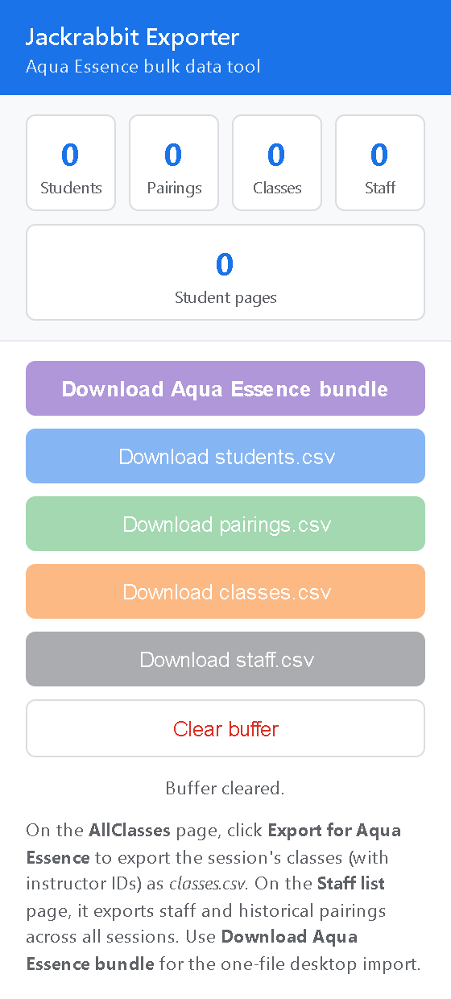
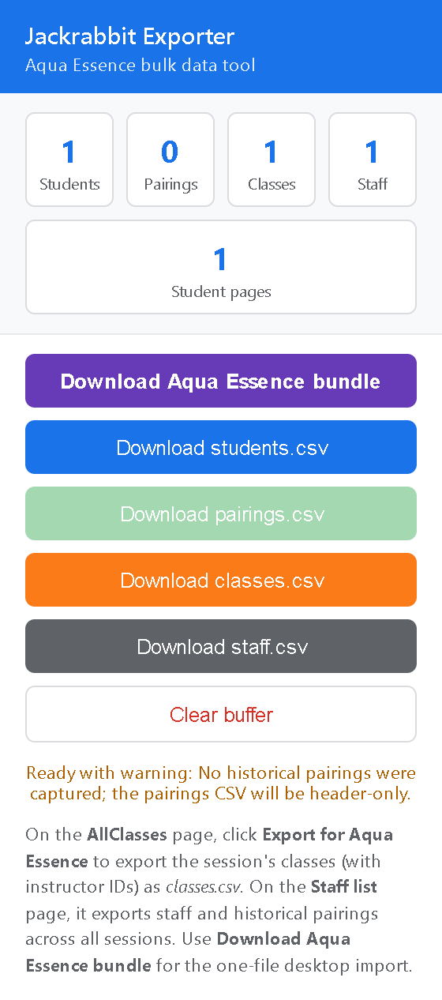

# Jackrabbit Exporter Setup and User Manual

[← Back to the starting page](../README.md#start-here)

## How to follow this manual

You are in the setup and user manual. Read it here on GitHub; there is no need
to download this page or open the code files.

- **First time using the exporter:** start with **Step 1** below, then follow the **Next** link at the end of each section.
- **Already installed it:** go straight to **Step 3** to capture records.
- **Need help:** click **Troubleshooting** below.
- **Lost your place:** use **Back to the steps** at the end of a section, or your browser’s Back button to return to the previous page.

Keep this manual open while you work. When the instructions ask you to open
another page, right-click its link and choose **Open link in new tab**. Click
the manual’s tab at the top of your browser to return to these instructions.

Extension version 1.1.0 · Bundle format 1 · 27 October 2026

This manual helps company staff install the exporter, capture authorized Jackrabbit records, and save the downloaded files securely. Use Chrome or Edge for the current company rollout.

### Before you begin

- Use Chrome or Edge version 121 or newer, a company approved computer, and an authorized Jackrabbit Class account.
- Download the approved exporter from GitHub using [Get the exporter from GitHub](#get-the-exporter-from-github), or obtain its ZIP or source folder from the company owner. Keep the extracted folder in a permanent company approved location.
- Choose a secure location for downloads. Exports can contain student notes and special needs information.

**Desktop import compatibility:** this published exporter produces format version 1. Confirm that the company has a desktop matcher build that supports format 1 before attempting import. A downloaded bundle alone does not confirm import support.

## Steps

1. [Step 1 — Get the exporter from GitHub](#get-the-exporter-from-github)
2. [Step 2 — Install in Chrome or Edge](#install-in-chrome-or-edge)
3. [Step 3 — Capture students classes and staff](#capture-students-classes-and-staff)
4. [Step 4 — Review and download](#review-and-download)

[Troubleshooting](#troubleshooting-and-data-handling)

[Company handover and maintenance](#company-handover-and-maintenance)

### Daily workflow

Clear the old buffer → capture every required list page → wait for completion → review counts and warnings → download → verify the saved file → clear the buffer when no longer needed.

## Get the exporter from GitHub

Staff can download the extension directly from the company’s GitHub repository. Git and Node.js are not required for this download method.

### Download the repository

1. Right-click the company download page link below and choose **Open link in new tab**. Switch to the new tab: [github.com/TheAquaEssence/jackrabbit-exporter-public](https://github.com/TheAquaEssence/jackrabbit-exporter-public)
2. Confirm with the company owner which published branch or release is approved for use. If a branch is specified, select it using the branch selector above the file list.
3. On the repository page, scroll to the top if needed. Look above the list of files for the **Code** button. Click **Code**, then click **Download ZIP** in its menu. This downloads the exporter files to your computer; your browser will usually put the ZIP in **Downloads** unless you choose another folder.
4. Open **File Explorer** on your computer and look in **Downloads** (or the folder you chose). Right-click the downloaded ZIP, choose **Extract All**, select a permanent company approved folder, and click **Extract**.
5. Open the extracted folder. GitHub usually adds the repository name and branch or tag to the folder name. Locate the folder that directly contains `manifest.json`. If there is an extra outer folder, open it first.
6. Click the manual’s browser tab to return here. Click **Next — Install in Chrome or Edge** below when you are ready. You will select the folder containing `manifest.json` during installation.

### If the company provides a release link

Open the specified release and download its Chromium extension ZIP from **Assets**, if supplied. Extract that ZIP and follow [Install in Chrome or Edge](#install-in-chrome-or-edge). Use the company approved release; the repository’s **Code → Download ZIP** option downloads the selected branch, which may contain newer development changes.

### If the repository will not open

Check the address with the company owner. A private repository requires a GitHub account with access; sign in using the authorized account or ask the owner to grant access. Do not change repository visibility to resolve an access problem.

### Updates and version checks

Downloading from GitHub does not install or automatically update the extension. For a new approved version, download and extract it again, then follow the update instructions under [Company handover and maintenance](#company-handover-and-maintenance). Keep the installed folder in place.

**Published version:** GitHub provides only changes that have been published there. Confirm the downloaded version in `manifest.json` and read its README or release notes. This manual describes the published format 1 exporter. Local development copies may contain newer features that are not included in this download.

[Next — Install in Chrome or Edge](#install-in-chrome-or-edge) · [Back to the steps](#steps) · [Back to the starting page](../README.md#start-here)

## Install in Chrome or Edge

1. If you received a ZIP, extract it first. Do not try to load the ZIP directly. Locate the extracted folder containing `manifest.json`, `popup.html`, `content.js`, `background.js`, `utils`, and `icons`.
2. In the browser address bar, enter `chrome://extensions/` for Chrome or `edge://extensions/` for Edge.
3. Turn on **Developer mode** and select **Load unpacked**. Select the folder containing `manifest.json`.
4. Find **Jackrabbit Exporter — Aqua Essence** in the extension list and confirm that it is enabled. If company policy blocks developer extensions, contact company IT.
5. Open the browser Extensions menu and pin the exporter for easy access. Open its popup to check that it responds.
6. Sign in to Jackrabbit using your usual account. Reload any Jackrabbit tabs that were already open before installation.

### Check the first installation

The popup should show counts of zero when the buffer is empty. The download controls remain disabled until the relevant records have been captured.

The blue **Export for Aqua Essence** button appears on Jackrabbit pages. Use the supported pages listed under [Capture students classes and staff](#capture-students-classes-and-staff) to capture records.

No Node.js installation or Aqua Essence desktop application is required to run this browser extension.

Figure 1. Exporter popup with an empty training buffer.

[Next — Capture students classes and staff](#capture-students-classes-and-staff) · [Back to the steps](#steps) · [Back to the starting page](../README.md#start-here)

## Capture students classes and staff

For a fresh snapshot, first open the popup and select **Clear buffer**. This removes previously captured records from extension storage. It does not change Jackrabbit records or delete downloaded files. Wait until any capture has finished or stopped before clearing.

1. **Students:** open the student list, choose the intended filters, and wait for the list to finish loading. Select **Export for Aqua Essence**. Wait for the completion feedback, then move to the next list page and repeat for every page in scope.
2. **Classes:** open **AllClasses**, select the intended session and filters, and export each visible list page separately. The exporter requests class details to obtain instructor IDs. This version does not verify or capture every current roster page through AllClasses. Wait for each capture to finish before changing pages.
3. **Staff and history:** open the staff list (**ListInstructors**) and select the same export control. This captures staff and requests historical class or enrollment information. Repeat for any additional visible staff list pages needed.
4. Open the exporter popup and review the captured counts and status. Students and classes are required for a bundle. Direct staff capture improves coverage; numeric instructor IDs from classes can supplement staff.

Figure 2. Actual exporter control on a neutral training page. Jackrabbit page layouts vary by account.

**Capture scope:** list exports follow the visible filters and rows. Student and outer class list pagination is not automatic. A nonzero count does not prove every page was captured. Keep track of your filters, sessions, and completed pages.

**Stop:** a Stop control appears during bulk capture. It stops scheduling further work; an in-flight request may finish. Already captured records remain buffered. A stopped capture may be incomplete.

[Next — Review and download](#review-and-download) · [Back to the steps](#steps) · [Back to the starting page](../README.md#start-here)

## Review and download

1. Wait until bulk progress has finished. Compare the buffer counts with your intended capture scope.
2. Read the message below the controls. Errors block bundle creation. Warnings allow download but identify data that may need recapture.
3. Select **Download Aqua Essence bundle**. Locate `aqua_essence_jackrabbit_export.json` in your browser downloads or selected save folder. The browser may add a suffix if the filename already exists.
4. Confirm the new file exists and is the intended export. Keep it in company approved storage. Do not rename CSV keys or edit identifiers.
5. Use it with the desktop matcher only after format 1 support is confirmed. When the capture is no longer needed, select **Clear buffer**.

Individual CSV buttons download `jackrabbit_students.csv`, `jackrabbit_classes.csv`, `jackrabbit_staff.csv`, and `jackrabbit_pairings.csv`. Their popup labels omit the `jackrabbit_` prefix.

Figure 3. Populated training buffer. An enabled download button can coexist with warnings.

### Understand the saved data

The bundle contains all four named CSV payloads. Pairings may be header-only if none were captured. Student detail pages can capture visible current and past enrollment pairings. Capture and review the required source pages; the bundle does not certify complete current membership coverage.

This version leaves Skill Level blank. Notes and Special Needs can reflect visible list values or indicators rather than full text. Do not infer an RSS level or medical information, or use blanks as proof that no information exists. Check the authorized Jackrabbit source.

[Next — Troubleshooting and data handling](#troubleshooting-and-data-handling) · [Back to the steps](#steps) · [Back to the starting page](../README.md#start-here)

## Troubleshooting and data handling

| What you see | What to do |
| --- | --- |
| No blue export button | Confirm the extension is enabled and you are on Jackrabbit. Reload the Jackrabbit tab after installation or an extension update. Use a supported page. |
| Bundle button is disabled | Read the status message. Capture at least one student and one class. Recapture records with invalid or missing IDs. |
| Missing enrollment or pairing records | Student detail pages capture visible current and past enrollment rows. Class detail captures visible students. Review those pages and capture additional pages as needed. Bundle readiness does not verify full roster coverage. |
| Missing student details | This version leaves Skill Level blank and does not verify full Notes or Special Needs text. Do not treat a count, flag, or blank as a complete student record. Check the authorized Jackrabbit source. |
| Capture fails or stops early | Check your network and Jackrabbit sign-in. Sign in again if needed, reload the supported page, and recapture. Review partial counts before downloading. |
| Could not reach background worker | Close and reopen the popup. If it persists, reload the extension from the browser extension page, then reload Jackrabbit and retry. |
| Unexpected or old records | The buffer accumulates captures. Once prior files are safely saved, clear it and recapture every required page with the correct filters. |

### Student data limitations

Format 1 has no Notes Capture Status or Special Needs Capture Status columns. The exporter does not verify full student notes or special needs text. A count or flag is not a description, and an empty field does not confirm the source is empty. Review the authorized Jackrabbit record before relying on these fields.

### Protect the export

Captured records remain in extension storage until Clear buffer is selected. Downloading does not clear them. The exporter uses your existing Jackrabbit session and does not send records to a third party. Downloaded copies remain after clearing; manage those under company retention rules. Never include operational records, medical text, credentials, session details, or screenshots of real data in support messages.

[Next — Company handover and maintenance](#company-handover-and-maintenance) · [Back to the steps](#steps) · [Back to the starting page](../README.md#start-here)

## Company handover and maintenance

### Items to hand over

- The company GitHub download link and approved branch or release, or a Chromium ZIP or complete extension folder, plus this manual and the privacy notice.
- A named company owner for distribution, updates, support, and storage or retention decisions.
- The intended Jackrabbit filters, sessions, and capture scope, recorded without copying private records.
- Confirmation of desktop format 1 compatibility before using the bundle in the matcher.

### Install an approved update

Save any needed downloads and let captures finish. Download the approved replacement files from GitHub using [Get the exporter from GitHub](#get-the-exporter-from-github), or obtain them from the company owner. If maintaining an unpacked installation, update the files in its permanent folder, open the extension management page, and select the extension’s Reload control. Reload Jackrabbit tabs, verify the extension version, and perform a fresh capture. Avoid mixing snapshots from different sessions or versions.

### Firefox setup for testing

Firefox 121 or newer can load the same source temporarily. Open `about:debugging#/runtime/this-firefox`, select **Load Temporary Add-on**, and choose `manifest.json` from the extracted folder. Firefox removes temporary add-ons after restart; permanent distribution requires Mozilla signing. Live Firefox validation was waived for the current company rollout, so Chrome or Edge is the recommended staff route.

### Information to include in a support request

Report the browser name and version, extension version, page type, non-sensitive error wording, whether capture finished, and aggregate counts. Describe the steps that led to the problem. Exclude student or staff names, record IDs, notes, authenticated endpoint URLs, and operational export files.

### Before leaving a capture session

1. Confirm all intended student and class list pages were captured.
2. Resolve blocking errors and assess extraction warnings.
3. Verify the downloaded file and store it securely.
4. Clear the extension buffer when the captured records are no longer needed.

Maintainer references supplied with the source repository: [README.md](../README.md) for capture behavior, [PRIVACY.md](../PRIVACY.md) for data handling, [RELEASE.md](../RELEASE.md) for packaging, and [MANUAL_VALIDATION.md](../MANUAL_VALIDATION.md) for live verification. End users do not need to run development commands.

[Back to the steps](#steps) · [Back to the starting page](../README.md#start-here)

## Offline copies

- [Printable PDF](manual/Jackrabbit%20Exporter%20Manual.pdf)
- [Standalone HTML manual](manual/Jackrabbit%20Exporter%20Manual.html) — download and open locally.
